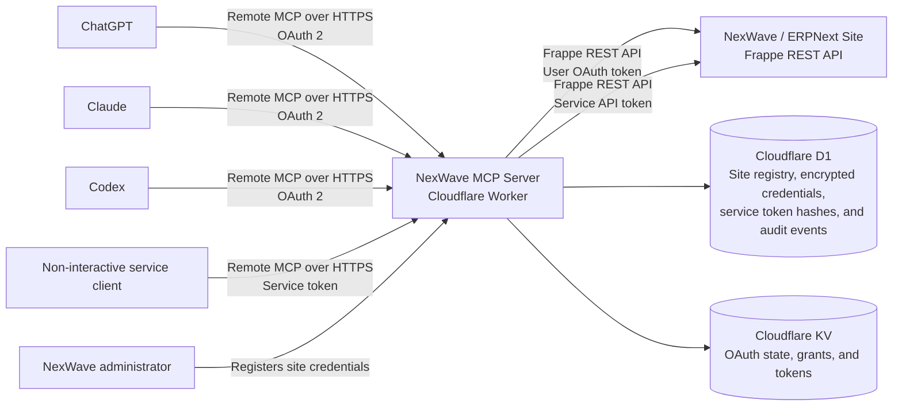

# NexWave MCP

NexWave MCP is a small, self-hosted gateway that connects AI clients such as ChatGPT, Claude, and Codex to a NexWave or ERPNext site.

It uses standard MCP with OAuth 2 for interactive users and Frappe API tokens for non-interactive service clients. It does not need a custom Frappe app and does not use `frappe_assistant_core`.

## Live POC

| Service | URL |
| --- | --- |
| MCP endpoint | `https://mcp.highflyertech.co.nz/mcp` |
| Service MCP endpoint | `https://mcp.highflyertech.co.nz/service/mcp` |
| Site setup | `https://mcp.highflyertech.co.nz/admin` |
| Health check | `https://mcp.highflyertech.co.nz/health` |

The setup page requires the private `ADMIN_TOKEN` Worker secret. Registered site names and URLs remain private.

## Usage logs

Authenticated MCP requests on `/mcp` and `/service/mcp` emit a structured `mcp_request` event to Cloudflare Workers Logs. Each event contains `site_id`, `site_name`, `auth_type` (`oauth` or `api_token`), a UTC start `timestamp`, a generated `request_id`, the MCP `method`, the registered `tool` name (or `null` for other methods), `outcome`, `error_code`, and `duration_ms`.

The `message` column shows a short summary, such as `MCP list_sales_invoices: success` or `MCP list_suppliers: error (PERMISSION_DENIED)`. It uses only the recorded method/tool, outcome, and safe error code; the other fields remain available for filtering and grouping.

Events are recorded when the MCP server produces a terminal reply. Tool errors are recorded as `error` even when the HTTP status is 200 or a service client uses `X-MCP-Error-Format: result`. Connections closed before a reply are recorded as `cancelled`. These events describe server execution, not confirmation that the client received the reply. Notifications and requests rejected before MCP dispatch, including authentication failures and malformed transport requests, do not produce usage events. Standard Worker invocation logs still cover HTTP requests.

Site identity comes from the authenticated connection. Usage logs exclude user email addresses, credentials, headers, request arguments, response data, and error text. Unregistered tool and method names are recorded as `unknown`. Site names are private operational data: keep log access limited to the operators who need it. No tool-usage history is written to D1.

After deployment, open **Workers & Pages > nexwave-mcp > Observability**, then filter events by `event = mcp_request`. Add `site_name`, `tool`, `outcome`, and `duration_ms` as columns. In the account-level **Observability > Query Builder**, filter to this Worker and event, then count events grouped by `site_name` and `tool`, or filter `outcome = error` to investigate failures. Save these queries for repeated use. The existing Wrangler configuration enables logs with 100% head sampling; storage limits and retention still depend on the Cloudflare plan.

See [Workers Logs](https://developers.cloudflare.com/workers/observability/logs/workers-logs/) and [Query Builder](https://developers.cloudflare.com/workers/observability/query-builder/).

## Architecture



The Worker is the protocol and security boundary between each AI client and each NexWave site.

| Component | Responsibility |
| --- | --- |
| MCP client | Discovers the server, authenticates, and calls tools |
| Cloudflare Worker | Handles MCP, OAuth, tool validation, and Frappe REST requests |
| D1 | Stores the private site registry, encrypted OAuth or API-token credentials, service token hashes, and sign-in audit events |
| KV | Stores short-lived OAuth state, grants, and MCP tokens |
| NexWave site | Authenticates the user and applies normal Frappe permissions |

## Authentication and request flow

1. The MCP client discovers the protected resource and OAuth metadata from the Worker.
2. The Worker asks the user for their exact NexWave site URL. It does not show a list of registered sites.
3. The Worker matches the URL origin against its private D1 registry.
4. The browser moves to the selected NexWave site for Frappe OAuth approval with PKCE S256.
5. After approval, the Worker returns control to the MCP client and issues an MCP token with the `nexwave:read` scope.
6. Each tool call uses the signed-in user's Frappe access token. Frappe applies that user's roles and document permissions.

Non-interactive clients can use the separate `/service/mcp` route. When an administrator registers a fixed API-token site, the Worker verifies the Frappe credentials and returns a generated service token once. It stores only the service-token hash and encrypted Frappe credentials in D1. A service client sends the generated token in the `X-NexWave-Service-Token` header. This route exposes the same read-only tool catalogue as `/mcp`.

Legacy JSON-RPC service tool calls receive finite `application/json` replies. Standard MCP tool failures retain `isError: true` by default. Clients that discard these errors can opt in with `X-MCP-Error-Format: result`. In that mode only, tool failures are delivered as normal MCP results containing `status: "error"`, `ok: false`, and a safe `error` object with `code`, `message`, and `retryable`. The client must check this envelope before using any data. Authentication failures and protocol errors keep their normal semantics. The OAuth `/mcp` route does not use this option.

Each MCP data tool has a shared 50-second upstream request budget, including any lookups and bounded retries of retryable reads. The service response handler allows 60 seconds to deliver the result or a safe error. Configure Retell's MCP `timeout_ms` as `90000` so it does not stop waiting before the server can return that error. OAuth sign-in and token-exchange timeouts are unchanged.

## Connect a client

Use this remote MCP endpoint in a client that supports OAuth-enabled remote MCP servers:

```text
https://mcp.highflyertech.co.nz/mcp
```

For Codex CLI and the Codex desktop app:

```sh
codex mcp add nexwave --url https://mcp.highflyertech.co.nz/mcp
codex mcp login nexwave
codex mcp get nexwave
```

The browser will ask for the NexWave site URL and then show that site's normal Frappe sign-in and access approval screens.

### Connect a non-interactive service client

Use the service endpoint when a client cannot complete an interactive OAuth flow:

```text
https://mcp.highflyertech.co.nz/service/mcp
```

Configure this request header:

```text
X-NexWave-Service-Token: <generated-service-token>
```

Add the site at `/admin`, select **Fixed API token**, and enter the API key and secret of a dedicated NexWave user. Copy the generated service token when the connection is saved. The same site URL can have one OAuth connection and one fixed-token connection. The gateway token is not a Frappe credential. The Worker uses its hash to select the registered site, decrypts the stored Frappe API token, and applies that service user's normal roles and permissions.

## Available tools

All tools are read-only. List results and report output are bounded to keep MCP responses manageable.

### Connection and master data

| Tool | Purpose |
| --- | --- |
| `get_current_user` | Show the connected site and user |
| `list_companies` | List accessible companies |
| `list_customers` | Search customers |
| `list_suppliers` | Search suppliers |
| `list_items` | Search items |
| `list_warehouses` | List company warehouses |
| `list_accounts` | List company ledger accounts |
| `list_cost_centres` | List company cost centres |
| `list_projects` | List company projects |
| `list_fiscal_years` | List enabled fiscal years |

### Transactions

| Tool | Purpose |
| --- | --- |
| `list_sales_orders` | List sales orders |
| `list_sales_invoices` | Search and filter sales invoices |
| `list_purchase_orders` | Search and filter purchase orders |
| `list_purchase_invoices` | Search and filter purchase invoices |
| `list_payments` | Search and filter payment entries |
| `list_bank_transactions` | Search and filter imported bank transactions |
| `get_document` | Get an allowlisted business document by exact name |

`get_document` supports Customer, Item, Sales Order, Sales Invoice, Purchase Order, Purchase Invoice, Payment Entry, and Bank Transaction.

### Reports

| Tool | Standard ERPNext report |
| --- | --- |
| `get_stock_balance` | Stock Balance |
| `get_stock_ledger` | Stock Ledger |
| `get_profit_and_loss` | Profit and Loss Statement |
| `get_trial_balance` | Trial Balance |
| `get_general_ledger` | General Ledger |
| `get_accounts_receivable` | Accounts Receivable |
| `get_accounts_receivable_summary` | Accounts Receivable totals, confirmed overdue, and top customer balances |
| `get_accounts_payable` | Accounts Payable |
| `get_bank_reconciliation_statement` | Bank Reconciliation Statement |

Report names and filters are allowlisted. Detailed reports have date-range limits and all report responses have row limits.

### Search and voice queries

Directory tools search record IDs and display names. If the full phrase has no exact match, they make one bounded token search and compare normalized names, including common legal suffixes for companies and parties. Fallbacks preserve explicit filters and permissions. Partial or ambiguous names require confirmation. Empty search strings and the existing text-array list responses remain supported; `structuredContent` adds match status, candidates, and truncation metadata.

Invoice and order tools accept `customer_query` or `supplier_query` for spoken names. Exact `customer` and `supplier` filters must use confirmed record IDs. Do not combine a spoken query and its exact filter. `search` is document text, not an unrestricted filter language. SQL wildcard characters in text are escaped.

Use `unpaid_only: true` for submitted positive invoice balances, including partly paid and overdue invoices. Use `overdue_as_of` for due dates strictly before a date. Neither can be combined with `status`. Purchase orders support `pending_receipt: true` for submitted, open orders with less than 100 percent received. List tools expose bounded, allowlisted sorting. Rank invoice/order `base_grand_total` with one company, `grand_total` with an exact document `currency`, and invoice `outstanding_amount` with an exact `party_account_currency`.

| Tool | Purpose |
| --- | --- |
| `get_party_balance` | Resolve a spoken customer/supplier name and return its company-currency balance; use `party_id` after confirming a candidate |
| `get_accounts_payable_summary` | Complete payable totals, credits, overdue balances and top parties |
| `get_sales_summary` | Net invoice sales by customer, item, item group or month, calculated before limiting displayed groups |
| `get_stock_risk` | Partial stock check against per-warehouse reorder settings, with explicit missing-setting and coverage warnings |

List tools accept `offset` (default `0`). Repeat the same search, filters, limit, and ordering with the returned `meta.next_offset`. Ordering includes a document-name tie-breaker. A full final page can require one empty request to confirm the end. Records can change between calls; pages are not a snapshot. The first text block remains the legacy record array. A second text block contains the same completeness and scope metadata as `structuredContent`, including delivery and ranking warnings.

Directory name searches keep their bounded ranked candidates by default. Their offsets page through that candidate set only. Use `search_mode: "literal"` from offset `0` to page through all literal text matches. Metadata distinguishes `ranked_candidates` from `literal_matches` and warns when candidate retrieval reaches its bound.

Use `summary: "count"` on a list tool to count all permission-visible matching documents, independent of offset and limit. Use literal mode when combining a directory search with a summary. Transaction lists also support `summary: "totals"`: invoice and order `grand_total` requires one company and document currency; payment `base_paid_amount` and `base_received_amount` require one company and use company currency; bank deposit, withdrawal, and unallocated totals require company and bank currency. Aggregates use fixed server-owned expressions through the same permission-aware Frappe list API. Filters, including document state, are retained. These are current document amounts, not recognised revenue, historical balances, or net cash. Use the receivables/payables tools for balances; invoice outstanding amounts can use a different party account currency.

For example, `list_sales_invoices` with `{ "company": "Example Company", "currency": "NZD", "docstatus": 1, "summary": "totals" }` returns the complete matching document count and grand total without returning invoice pages.

Invoice lists and `get_document` include `party_account_currency` beside `outstanding_amount`. Sorting invoices by `outstanding_amount` requires an exact `party_account_currency` filter; a document `currency` filter alone does not make balances comparable. Sorting `grand_total` still requires document `currency`, and sorting `base_grand_total` requires one company. Ranking metadata names the amount field, currency, and source currency field in both structured and text output. Invoice total summaries remain in document currency.

All 30 tools advertise object output schemas and read-only annotations. Successful results include `structuredContent` with their existing text content preserved. List contracts cover pages, count/total summaries, and party-confirmation results. Master-data tools advertise `summary: "count"` only; the six transaction lists also advertise `"totals"`. These annotations describe behavior; Frappe still enforces permissions.

Standard row-based report tools accept `offset` and return `next_offset`, `row_count`, and visible completeness warnings. Each call reruns the report; output pagination does not reduce upstream report size or execution time. Compact summaries retain their existing complete totals and top-result limits.

`get_document` now returns selected item fields for sales/purchase orders and invoices, invoice allocation references for Payment Entry, and payment links for Bank Transaction. Use `detail_limit` (default `20`, maximum `50`) and `detail_offset` with `detail_meta.<table>.next_offset`. Each table reports its full row count and page completeness. Missing tables remain unavailable. An empty table can also mean field permissions hid its contents, so empty-table completeness is not claimed. Payment details include both account currencies for reference-amount context. Custom fields and internal fields are excluded; Frappe still enforces parent-document and field permissions.

Date-range reports accept either the existing explicit `from_date`/`to_date` pair or `period` plus `as_of_date` (the user's current local calendar date). Presets are `current_fiscal_year`, `last_month`, and `last_90_days`. Fiscal years are resolved by NexWave for the specified company. Do not mix presets with explicit dates. Ledger and sales-summary ranges remain bounded to 366 days.

Tool execution shares a 50-second upstream budget for service-token and OAuth clients. Responses are bounded to 8 MiB. Upstream timeouts, invalid JSON, permission failures and oversized results return safe MCP errors; none mean that no records exist. Read-only upstream requests get at most one retry inside the same 50-second budget when the failure is retryable. Authentication routes, stored credentials and null-argument normalization are unchanged. No database migration is needed.

The stock-risk report covers existing item/warehouse stock rows only. It does not implement missing-Bin replenishment, warehouse-group reorder rules, demand forecasts or lead-time forecasts. A zero returned risk count is not evidence that all stock is safe.

The deployment-ready [voice prompt](docs/voice-agent-prompt.md) and [evaluation cases](docs/voice-evaluation.md) describe the intended client behavior. Deploy the MCP changes, refresh the client's tool catalogue, and then publish the updated voice configuration. Keep all existing tools selected.

The receivable summary adds `totals.overdue` when `overdue_complete` is true. It uses positive document balances due strictly before `report_date`, includes the overdue part of the first ageing bucket, and does not deduct unallocated credits. Missing due dates fall back to posting dates, as in the standard report. If dates or per-customer detail reconciliation are incomplete, the overdue field is omitted rather than reported as zero. Existing totals, ageing buckets and filters are unchanged, and no extra upstream report request is required. The voice prompt also supports sequential, customer-scoped summaries across balances, sales and relevant invoice/order tools, with explicit partial-result handling.

Party and payable summaries also expose `overdue_complete` and omit overdue amounts when positive documents lack valid dates, while preserving their other balance totals. The prompt requires this confirmation on all three summaries. It can be published safely before the MCP update, but will report overdue as unavailable until the new field is deployed.

## Local development

Requirements:

- Node.js 22 or newer
- A Cloudflare account for deployment
- A Frappe v15, ERPNext, or NexWave site

Install dependencies, create local storage, and start the Worker:

```sh
npm ci
cp .dev.vars.example .dev.vars
npm run db:local
npm run dev
```

Open `http://localhost:8787/admin`.

For an OAuth site, create an **OAuth Client** on the Frappe site with these settings:

| Field | Value |
| --- | --- |
| App Name | NexWave MCP |
| Scopes | `all openid` |
| Redirect URIs | `http://localhost:8787/oauth/frappe/callback` |
| Default Redirect URI | `http://localhost:8787/oauth/frappe/callback` |
| Grant Type | Authorization Code |
| Response Type | Code |
| Skip Authorization | Off |

Copy the generated client ID and secret into the local setup page and select **OAuth 2**. A local Frappe bench can use `http://localhost:8000` when the required site is the bench default.

For a non-interactive service connection, create an API key and secret for a dedicated NexWave user. In the setup page, select **Fixed API token**. The page shows the generated service token once after it verifies and saves the connection.

## Cloudflare deployment

The Worker needs one KV namespace and one D1 database. Replace the account and resource IDs in `wrangler.jsonc` before deploying a fork to another Cloudflare account.

Set the Worker secrets. Do not store them in source control:

```sh
openssl rand -base64 32 | wrangler secret put ADMIN_TOKEN
openssl rand -base64 32 | wrangler secret put CONFIG_ENCRYPTION_KEY
```

Apply migrations and deploy:

```sh
npm run db:remote
npm run deploy
```

For a Worker at `https://nexwave-mcp.example.workers.dev`, add this redirect URI to the Frappe OAuth Client:

```text
https://nexwave-mcp.example.workers.dev/oauth/frappe/callback
```

Register the site at `/admin`, then give users the `/mcp` endpoint.

GitHub Actions validates each push and pull request to `main`. It does not deploy automatically.

## Security model

- Site OAuth client secrets and fixed API-token credentials are encrypted with AES-256-GCM before D1 storage.
- The OAuth Provider library encrypts upstream tokens and refresh properties in KV.
- OAuth approval state expires after ten minutes and is bound to the same browser with an HTTP-only cookie.
- Frappe sign-in uses PKCE S256 and the confidential client secret.
- The admin API requires a separate bearer token.
- The service MCP route accepts a generated gateway token and maps its stored hash to one registered fixed-token site.
- A generated service token is returned only once. D1 stores its hash, not the token value.
- Fixed Frappe API credentials are encrypted in D1 and are never returned to the MCP client.
- Production site URLs must use HTTPS. Plain HTTP is accepted only for local development hosts.
- Tools cannot call arbitrary Frappe methods, reports, DocTypes, fields, or URLs.
- The public consent page does not enumerate registered site names or URLs.
- Frappe remains the source of truth for user permissions.

The POC records successful and failed sign-in events. It does not yet include a full audit viewer, write tools, per-tool scopes, automatic deployment, or managed secret rotation.

## Quality checks

Run the same validation used by CI:

```sh
npm run check
npm test
npm run test:runtime
npm run test:live # Requires Docker Compose v2
npx wrangler deploy --dry-run
```

`test:live` creates a fresh ERPNext v15.109.0 site, MariaDB, and Redis from pinned container images. It bundles the actual Worker entry point, applies D1 migrations, registers generated API tokens, and calls `/service/mcp`. A test-only network bridge forwards requests to the real local Frappe API. Expected amounts come from synthetic invoices and payments, not a second copy of the tool query.

The suite checks list pages, counts, totals, document and account currencies, item and payment-reference details, receivables/payables, sales, General Ledger, and access for three API users (all companies, one company, and no accounting access). It uses fixed January 2025 dates. The script removes its containers, volumes, and temporary credentials on exit. CI needs no repository secrets. Neither credentials nor site logs are uploaded.

The `Live Frappe` and `Worker checks` jobs must both pass for the required `Validate` check to pass. This first backend covers the standard ERPNext API contract; NexWave app overrides and OAuth browser login need separate coverage.

The protected `main` branch requires a pull request, resolved review conversations, and a passing `Validate` check. Contributors need one approval; the current repository administrators can bypass the approval requirement.

See [AGENTS.md](AGENTS.md) for contributor and coding-agent rules.
